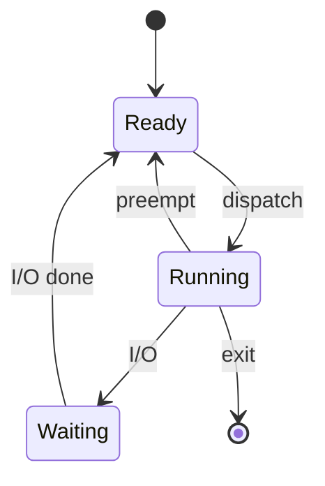

# Operating Systems: Scheduling

Today's topics: **CPU scheduling**, *preemption*, and the `CFS` scheduler used by Linux.

## Goals of a scheduler

1. Maximize **throughput**
2. Minimize *response time* for interactive tasks
3. Be fair
   - no starvation
   - weights via `nice` values

> "Scheduling is the art of choosing who waits." (from the lecture)

## Process states

## Comparison of algorithms

| Algorithm | Preemptive | Starvation | Typical use |
|-----------|:----------:|:----------:|-------------|
| FCFS      | no         | no         | batch jobs |
| SJF       | no         | yes        | when burst times are known |
| Round robin | yes      | no         | time sharing |
| CFS       | yes        | no         | Linux desktop and server |

## Exercise

- [x] Read chapter 5
- [ ] Simulate round robin with quantum 4
- [ ] Compare average waiting time with SJF
